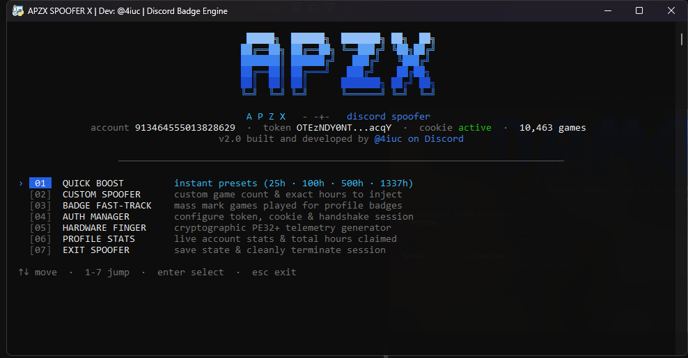

<div align="center">

# ⚡ DISCORD BADGES SPOOFER — LATEST UPDATE ⚡
### APZX SPOOFER X • High-Velocity Science Telemetry Engine
**Developed by APZXCORE • Core Engine by @4iuc**

<p align="center">
  <a href="https://github.com/APZXCORE/APZX-SPOOFER-X">
    
  </a>
</p>

[](https://github.com/APZXCORE/APZX-SPOOFER-X)
[](https://github.com/APZXCORE/APZX-SPOOFER-X)
[](https://www.python.org/)
[](./LICENSE)
[](#)

<p align="center">
  <b>A lightweight, zero-dependency Discord utility for Windows designed to simulate authentic game activity, accelerate profile playtime milestones, and fast-track Games-Played profile badges via Discord's native telemetry protocol.</b>
</p>

<!-- PREVIEW SHOWCASE -->
<br />
<p align="center">
  <a href="https://github.com/APZXCORE/APZX-SPOOFER-X">
    
  </a>
</p>
<p align="center">
  <i>Console Command Center TUI with Live Arrow-Key Navigation and Cyan-Cobalt Gradient Shading</i>
</p>
<br />

[Access Download](#-get-access-to-apzxcore-projects) • [Features](#-features) • [Installation](#-installation-and-usage) • [FAQ](#-troubleshooting-and-faq) • [Community](#-credits-and-community)

---

</div>

## 📌 About The Project

**Discord Badges Spoofer** (APZX SPOOFER X) is a specialized Windows utility developed under the **APZXCORE** ecosystem. The tool interfaces directly with Discord's private analytics stream (`/api/v9/science`) to dispatch legitimate, structured client telemetry event sequences:
- `launch_game`
- `running_game_heartbeat`

By dispatching cryptographic heartbeat sequences across an integrated catalog of **10,459 verified Discord detectable games**, the engine accurately logs elapsed playtime hours and increments game counts directly linked to your Discord account profile.

### 🔍 Badge Simulation Transparency
- **Playtime Accrual**: The tool emits genuine telemetry events accepted by Discord's science gateway (`HTTP 204 No Content`).
- **Batch Processing Notice**: Discord aggregates profile activity and badge awards in periodic background batch cycles (typically updating every **24 to 48 hours**). Badges do not appear instantaneously upon payload dispatch.
- **Scope & Limitations**: This utility does not modify Discord's server databases, unlock server-restricted permissions, bypass payment gateways, or grant official staff badges (e.g., Discord Staff, Bug Hunter, Partner). It operates exclusively as a client-side game telemetry and badge milestone simulator.

---

## ⚡ Features

| Feature | Description |
| :--- | :--- |
| **⚡ Quick Boost Presets** | Instant one-click playtime inflation presets: `25h` (Natural), `100h` (Silver/Gold milestone), `500h` (Master tier), `1,337h` (Elite flex), and `5,000h` (Ultra max). |
| **🎯 Badge Fast-Track** | Rapidly dispatches low-duration sessions across hundreds of games simultaneously to accelerate unlocking the "Games Played" profile badge. |
| **🛠️ Custom Spoofer Engine** | Complete manual control over the target game pool count and exact playtime hours to inject. |
| **🔒 Cryptographic PE32+ Fingerprinting** | Uses PowerShell and Win32 Crypto32 APIs to extract Authenticode signatures and PE32+ section hashes from real binaries (Steam, Riot, Epic, Discord), binding them to your Machine GUID. |
| **⌨️ Interactive Cyber TUI** | Built-in high-performance Windows console menu with live arrow-key scrolling (`↑`/`↓`), numeric shortcuts (`1-7`), electric cobalt pill badges, and zero-flicker VT redraws. |
| **📦 10,459 Detectables Catalog** | Pre-bundled with Discord's complete detectable game database (`games.json`) for instant offline operation. |
| **🛡️ Zero Dependencies** | Written in 100% standard Python 3.10+ library code. No `pip install` or external packages required. |
| **🔐 Local Credential Isolation** | All authentication tokens and cookies remain strictly isolated in your local `science_state.json` file. No third-party network transmission. |

---

## 🚀 Get Access To APZXCORE Projects

Downloads and project builds for **APZXCORE** utilities are distributed exclusively through our automated Discord verification system to ensure community integrity and protect against malicious mirrors.


### Exact Access Steps:

1. **Join the Discord Community**:
   - Connect to the official [APZXCORE Discord Server](https://discord.gg/apzxcore).
2. **Open the Repository**:
   - Navigate to the official repository: [github.com/APZXCORE/APZX-SPOOFER-X](https://github.com/APZXCORE/APZX-SPOOFER-X).
3. **Star the Repository**:
   - Click the ⭐ **Star** button at the top-right corner of the GitHub repository page.
4. **Return to Discord**:
   - Navigate to the designated `#verify` or `#bot-access` channel within the APZXCORE server.
5. **Trigger Verification**:
   - Run `/verify` or click the **Verify Eligibility** button on the pinned verification bot panel.
6. **Confirm Connection**:
   - Link your GitHub account to confirm that you have starred the repository.
7. **Obtain Your Build**:
   - Once verified, the bot will immediately grant you the **Verified Member** role and provide direct access to the latest release package.

> [!NOTE]
> Starring the repository alone does not deliver files to your inbox. The access token is granted by the server verification bot after eligibility confirmation.

---

## 💻 Interactive Terminal Interface

The tool features an interactive command-center TUI styled with an electric-cobalt theme:

```text
                       █████╗  ██████╗  ███████╗ ██╗  ██╗                       
                      ██╔══██╗ ██╔══██╗ ╚══███╔╝ ╚██╗██╔╝                       
                      ███████║ ██████╔╝   ███╔╝   ╚███╔╝                        
                      ██╔══██║ ██╔═══╝   ███╔╝    ██╔██╗                        
                      ██║  ██║ ██║      ███████╗ ██╔╝ ██╗                       
                      ╚═╝  ╚═╝ ╚═╝      ╚══════╝ ╚═╝  ╚═╝                       

                       A P Z X   - -+-   discord spoofer
        account: 913464555013828629  ·  token: active  ·  cookie: active  ·  10,463 games
                  v2.0 built and developed by @4iuc on Discord
────────────────────────────────────────────────────────────────────────────────

  › 01   QUICK BOOST         instant presets (25h · 100h · 500h · 1337h)
   [02]  CUSTOM SPOOFER      custom game count & exact hours to inject
   [03]  BADGE FAST-TRACK    mass mark games played for profile badges
   [04]  AUTH MANAGER        configure token, cookie & handshake session
   [05]  HARDWARE FINGER     cryptographic PE32+ telemetry generator
   [06]  PROFILE STATS       live account stats & total hours claimed
   [07]  EXIT SPOOFER        save state & cleanly terminate session

  ↑↓ move  ·  1-7 jump  ·  enter select  ·  esc exit
```

---

## 📦 Installation and Usage

### Prerequisites
- **Operating System**: Windows 10 or Windows 11 (64-bit recommended)
- **Runtime**: [Python 3.10](https://www.python.org/downloads/) or newer (ensure `Add Python to PATH` is checked during installation)

### Setup Instructions

1. **Extract Release Files**:
   Download the verified release package and extract it to a directory on your machine.

2. **Launch the Engine**:
   - Double-click `launch.bat`  
     *OR*
   - Open PowerShell or Command Prompt in the project folder and run:
     ```powershell
     python spoofer.py
     ```

3. **Configure Authentication Credentials**:
   On first launch, you will be prompted to enter your credentials (stored locally in `science_state.json`):
   - **Account Token**:
     1. Open Discord in your browser or desktop client.
     2. Press `Ctrl + Shift + I` to open Developer Tools, then switch to the **Network** tab.
     3. Filter by `messages` or `science`.
     4. Select a request and copy the `Authorization` header value.
   - **Cloudflare Cookie (`cf_clearance`)**:
     1. In Developer Tools, select any request targeting `/api/v9/science`.
     2. Locate the `Cookie` header and copy the `cf_clearance` string value.

4. **Select Operation**:
   Use `↑`/`↓` arrow keys to navigate the menu, press `Enter` to confirm, or press numbers `1-7` to jump directly.

---

## 📷 Screenshots and Visual Showcase

<div align="center">
  <a href="./assets/preview.png">
    
  </a>
  <p><b>Figure 1:</b> <i>APZX SPOOFER X interactive command center running on Windows Terminal with active session telemetry and detectable games catalog.</i></p>
</div>

| Mode / Feature | Visual Indicator | Functionality |
| :--- | :--- | :--- |
| **Command Center TUI** | Cyan-to-Cobalt Block Gradient | Zero-flicker VT console navigation with arrow-keys (`↑`/`↓`) and number shortcuts (`1-7`). |
| **Status Stream** | Live Account & Token Indicators | Monitors Discord session validity, Cloudflare clearance cookie, and total indexed games (10,463). |
| **Pill Highlight** | Electric Cobalt Active Pill (`01`) | High-contrast cursor selection for error-free terminal operation. |
| **Engine Execution** | Native Python Runtime | Zero latency, low CPU overhead, and instantaneous response. |

---

## ❓ Troubleshooting and FAQ

<details>
<summary><b>1. How do I obtain access to the tool?</b></summary>
<br>
Join the official <a href="https://discord.gg/apzxcore">APZXCORE Discord Server</a>, star this GitHub repository, and trigger the verification process in the <code>#verify</code> channel.
</details>

<details>
<summary><b>2. Why do I need to star the repository?</b></summary>
<br>
Starring the repository helps support open-source development, increases project visibility, and authenticates your eligibility through our automated distribution bot.
</details>

<details>
<summary><b>3. What should I do if verification fails?</b></summary>
<br>
Ensure your GitHub profile visibility is set to public and that your account is successfully linked to the verification bot. If issues persist, open a ticket in the APZXCORE support channel.
</details>

<details>
<summary><b>4. Does this tool grant official Discord staff or partner badges?</b></summary>
<br>
No. The tool simulates game activity events for Discord's official playtime and games-played profile badges. It does not alter server-level permissions, grant Discord Staff badges, or modify account entitlements.
</details>

<details>
<summary><b>5. When will the badge show up on my Discord profile?</b></summary>
<br>
Discord does not refresh badge metrics instantly. Profile analytics are calculated during Discord's backend aggregation batches, which typically run every <b>24 to 48 hours</b>.
</details>

<details>
<summary><b>6. What does HTTP 401 or HTTP 403 mean during injection?</b></summary>
<br>
HTTP 401 or 403 indicates that your Cloudflare cookie (<code>cf_clearance</code>) has expired. Cloudflare cookies are refreshed periodically by Discord. Simply open Option 4 in the menu and update your cookie with a fresh value.
</details>

<details>
<summary><b>7. Are my credentials safe?</b></summary>
<br>
Yes. Your Discord Account Token and Cookie are stored strictly on your local computer inside <code>science_state.json</code>. They are sent directly to official Discord endpoints (<code>discord.com/api/v9/science</code>) and nowhere else. Never commit or upload your <code>science_state.json</code> file.
</details>

---

## 🔒 Security & Responsible Use

- **Local Storage**: Your Discord Token, Cookie, and Machine GUID hashes are saved strictly in `science_state.json` on your local disk.
- **No Third-Party Analytics**: This software contains no third-party tracking, telemetry collectors, or external keyloggers.
- **Terms of Service**: Automated dispatch of science telemetry events interacts directly with Discord's private APIs and may violate Discord's Terms of Service. Use responsibly and at your own discretion.

---

## 👥 Credits and Community

**Discord Badges Spoofer** is built and maintained by **APZXCORE**.

- **Lead Developer**: [@4iuc on Discord](https://discord.gg/apzxcore)
- **Official Repository**: [APZXCORE/APZX-SPOOFER-X](https://github.com/APZXCORE/APZX-SPOOFER-X)
- **Community Discord**: [Join APZXCORE Community](https://discord.gg/apzxcore)
- **Issue Tracker**: [Report Bugs & Suggestions](https://github.com/APZXCORE/APZX-SPOOFER-X/issues)

---

## 🏷️ Search Engine Optimization

*Keywords: Discord Badges Spoofer, Discord Badges Spoofer Latest Update, Discord badge simulator, Discord badge preview tool, Discord utility for Windows, APZXCORE, Discord tool latest version, Discord badge customization utility, Discord science telemetry inflator, Discord playtime booster, APZX Spoofer X.*

---

<div align="center">

### ⭐ STAR THE REPOSITORY · JOIN THE COMMUNITY · VERIFY · GET ACCESS ⭐

**[APZX-SPOOFER-X Repository](https://github.com/APZXCORE/APZX-SPOOFER-X) • [Join Discord Server](https://discord.gg/apzxcore)**

*Copyright © 2026 APZXCORE. All rights reserved.*

</div>
